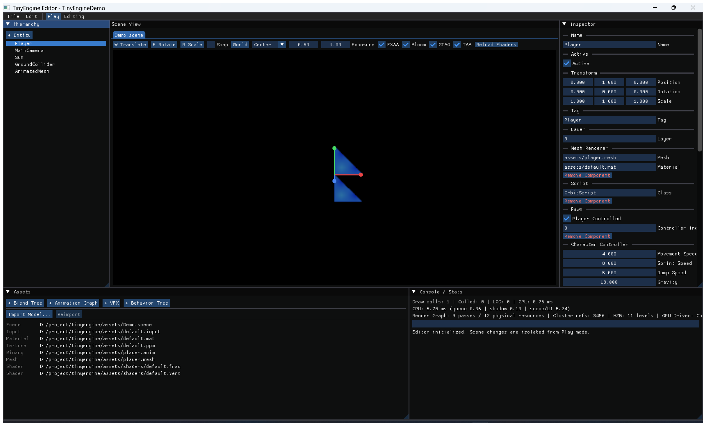

# TinyEngine 使用指南

## 1. 打开示例项目

完成 Debug 构建后运行：

```powershell
.\build\Debug\tinyengine_editor.exe TinyEngine.tinyproject
```

项目文件中的路径相对于 `.tinyproject` 所在目录解析。示例项目使用：

```ini
project.name=TinyEngineDemo
project.assets=assets
project.startupScene=assets/Demo.scene
project.cooked=Saved/Cooked
input.bindings=assets/default.input
physics.fixedStep=0.016666667
```

主要字段：

- `project.name`：编辑器标题和打包后的可执行文件基础名。
- `project.assets`：资产根目录。
- `project.startupScene`：启动场景。
- `project.cooked`：Cook 输出目录。
- `project.package`：发布项目使用的 TPAK；通常由打包器写入。
- `input.bindings`：`.input` 映射资产。
- `render.environment`：可选 `.env` 环境资产。
- `physics.fixedStep`：固定物理步长。

## 2. 编辑器布局与操作

下图为实际运行 TinyEngine 0.27 Release 编辑器并打开示例项目后的默认界面：



默认布局由五个固定区域组成：

| 区域 | 位置 | 用途 |
|---|---|---|
| Hierarchy | 左上 | 查看实体父子层级，选择实体，创建和批量删除实体 |
| Scene View | 中上 | 编辑场景、控制编辑器相机、框选实体并操作 Gizmo |
| Inspector | 右上 | 编辑所选实体的组件，或编辑 Assets 中选中的材质 |
| Assets | 左下 | 浏览、导入、重导入、移动、预览和修复资产 |
| Console / Stats | 右下 | 执行控制台命令，查看日志以及 CPU/GPU/Render Graph 统计 |

### 2.1 顶部菜单和运行状态

- `File > Save Scene`：保存当前场景，等同于 `Ctrl+S`。
- `File > New Scene`：创建新的场景标签。
- `File > Restore Autosave`：恢复 `Saved/EditorAutosave.scene`；没有恢复文件或处于 Play 状态时不可用。
- `File > Package Project`：保存场景并把项目打包到 `Dist/<项目名>`。
- `Edit > Undo/Redo`：撤销或重做编辑操作。
- `Play`：进入运行状态，按钮会变成 `Stop`，右侧状态由 `Editing` 变为 `Runtime`。
- `Stop`：退出运行状态并恢复进入 Play 前的编辑场景快照。

编辑器进入 Play 前保存内存快照，退出 Play 时恢复，因此运行时产生的 Transform、物理或 Gameplay 修改不会污染编辑场景。未保存场景每 30 秒自动写入恢复文件。

### 2.2 Hierarchy 实体层级

- 点击 `+ Entity` 创建空实体。
- 单击实体进行单选；按住 `Ctrl` 单击可以追加选择或从选择集中移除。
- 有子实体的节点可以展开或折叠，父子关系来自 `RelationshipComponent`。
- 选中实体后按 `Delete` 批量删除当前选择集。
- 主选中实体是最后选中的实体，Inspector 默认编辑该实体。

### 2.3 Scene View 场景视图

Scene View 顶部工具条从左到右包括：

- `W Translate`、`E Rotate`、`R Scale`：切换平移、旋转和缩放 Gizmo。
- `Snap`：启用步长吸附；旁边的数值根据当前模式表示移动距离、旋转角度或缩放步长。
- `World/Local`：切换世界坐标轴和实体局部坐标轴。
- `Center/Active/Individual`：设置多选 Gizmo 中心。`Center` 使用选择集中心，`Active` 使用主实体，`Individual` 分别修改各实体。
- `Exposure`：调整 HDR Tone Mapping 曝光。
- `FXAA`、`Bloom`、`GTAO`、`TAA`：实时启用或关闭对应后处理。
- `Reload Shaders`：重新编译默认 Shader；失败时继续使用上一份有效程序，并把错误写入 Console。

Scene View 鼠标与键盘操作：

- 按住鼠标右键并使用 `W/A/S/D/Q/E` 飞行，`Shift` 加速。
- 左键单选；拖动空白区域框选；`Ctrl` 追加或移除选择。
- `W/E/R` 切换平移、旋转、缩放 Gizmo。
- 拖动红、绿、蓝 Gizmo 轴修改 X、Y、Z；启用 Snap 后按设定步长变化。
- 从 Assets 把 `.prefab`、`.mesh` 或 `.mat` 拖入 Scene View，可以实例化 Prefab、创建 Mesh 实体或给选中实体应用材质。

### 2.4 Inspector 属性面板

- 选中实体后，Inspector 通过反射系统列出该实体已有组件及可编辑字段。
- `Add Component` 添加尚未存在的可移除组件；组件标题下的 `Remove Component` 删除组件。
- Transform、物理数值、枚举、布尔值、颜色和资产路径使用对应控件编辑。
- 资产字段会先经过 Asset Registry 类型检查；类型不匹配时拒绝赋值并在 Console 输出原因。
- 多选时 Inspector 提示选择数量，字段编辑以主实体为入口；批量 Gizmo 操作会作用于整个选择集。
- Assets 中选中 `.mat` 时，如果当前没有实体选择，Inspector 会显示材质颜色、Metallic、Roughness、贴图、父材质和显式 Override。

### 2.5 Assets 资产面板

面板顶部可以直接创建：

- `+ Blend Tree`
- `+ Animation Graph`
- `+ VFX`
- `+ Behavior Tree`

常用资产操作：

- `Import Model...`：选择 FBX、glTF、OBJ 等源模型，设置输出目录和资源前缀后提交后台 Assimp 导入。
- `Reimport`：使用 `.meta` 中保存的源文件和导入设置重新生成当前资产。
- 单击资产：选中并显示类型、路径、缩略图或专用编辑窗口。
- 右键 `Move / Rename...`：移动资产，并同步更新 `.meta`、依赖和文本引用。
- 右键 `Regenerate Thumbnail`：重新生成模型、材质或纹理缩略图。
- 缺失依赖区域会列出候选资产；点击 `Repair -> <路径>` 交互式修复引用。
- 把 Prefab 或 Scene 拖到 Scene View；Scene 资产也可以作为新的场景标签打开。

选择不同扩展名时会打开相应工具窗口：

- `.skanim`、`.blendtree`、`.animgraph`：Animation Graph / Events。
- `.vfx`：VFX Editor。
- `.btgraph`：Behavior Tree Editor。
- `.vert`、`.frag`：Shader Source Editor。
- `.matgraph`：Material Graph。

### 2.6 Console / Stats

输入命令后按 Enter 执行。常用示例：

```text
r.Bloom false
r.GTAO true
r.TAA true
r.FXAA false
r.GpuBudgetMB 512
r.TrimGpu
```

统计区显示：

- Draw Calls、CPU 剔除数、LOD 切换数和 GPU 帧耗时。
- CPU Queue、Shadow、Scene/UI 和整帧耗时。
- Render Graph Pass 数与物理资源数。
- Cluster Light Reference 数量和 HZB 层数。
- GPU Driven 当前使用 `Compute + Indirect`、`CPU cull + Indirect` 或直接绘制回退。

### 2.7 常用快捷键

- `Ctrl+Z` / `Ctrl+Y`：Undo / Redo。
- `Ctrl+S`：保存当前场景。
- `Ctrl+C` / `Ctrl+V`：通过临时 Prefab 复制和粘贴实体。
- `Delete`：删除选择集。
- `W/E/R`：切换 Gizmo 模式。

## 3. 导入模型

编辑器 Assets 面板选择“Import Model”，或使用：

```powershell
.\build\Debug\tinyengine_asset_tool.exe import `
  D:\Models\Character.fbx assets/Character assets/Character
```

Assimp 导入器会按源内容生成 `.mesh`、`.mat`、`.prefab`、`.skeleton` 和 `.skanim`，并生成稳定 `.meta`。蒙皮顶点保留权重最高的四根骨骼并归一化；同一模型的多个 Mesh 使用统一骨骼编号。

导入是 Authoring 流程。独立游戏不读取 FBX/glTF，而只读取转换后的轻量资产。

## 4. 创建和编辑专用资产

Assets 面板可创建：

- `.blendtree`：1D 动画混合树。
- `.animgraph`：参数、状态、转换和交叉淡化。
- `.vfx`：发射、生命周期、纹理 Flipbook 与 CPU/GPU 模式。
- `.btgraph`：行为树节点图。
- `.matgraph`：可视化材质节点图。

Shader Editor 编辑 `.vert/.frag` 时会调用真实 OpenGL 编译器。失败时保留上一份有效 Program，并显示驱动错误与行号。

## 5. 资产维护

扫描资产：

```powershell
.\build\Debug\tinyengine_asset_tool.exe scan assets
```

查找缺失依赖：

```powershell
.\build\Debug\tinyengine_asset_tool.exe missing assets
```

生成缩略图：

```powershell
.\build\Debug\tinyengine_asset_tool.exe thumbnail assets/player.mesh Saved/player.ppm
```

大型文件分块：

```powershell
.\build\Debug\tinyengine_asset_tool.exe chunk Movie.bin Saved/Movie.chunkmanifest 4194304
```

移动或重命名资产应从编辑器资产操作入口完成，使 `.meta`、依赖和文本引用同步更新。不要只在文件管理器中移动单个资产。

## 6. 环境光照

```powershell
.\build\Debug\tinyengine_asset_tool.exe bake-env `
  assets/Environment.hdr assets/EnvironmentBaked
```

产物包含六面 Irradiance Atlas、六级 GGX Prefilter Atlas、BRDF LUT 和 `.env` 清单。把 `.env` 路径写入项目的 `render.environment`。

## 7. 运行

开发 Demo：

```powershell
.\build\Debug\tinyengine_demo.exe
```

参数 `3` 表示只运行三帧，适合自动化冒烟：

```powershell
.\build\Debug\tinyengine_demo.exe 3
```

独立 Runtime：

```powershell
.\build\Debug\tinyengine_game.exe TinyEngine.tinyproject --frames=3
```

## 8. 校验、Cook 和打包

提交或打包前建议依次执行：

```powershell
.\build\Debug\tinyengine_commandlet.exe ValidateAssets assets
.\build\Debug\tinyengine_commandlet.exe ValidateScenes Saved
.\build\Debug\tinyengine_commandlet.exe CookProject `
  TinyEngine.tinyproject Saved/PlatformCook Windows Shipping
```

一键生成示例游戏包：

```powershell
cmake --build build --config Release --target package_game
```

或显式调用打包器：

```powershell
.\build\Release\tinyengine_package_tool.exe `
  TinyEngine.tinyproject `
  Saved/Package/TinyEngineDemo `
  .\build\Release\tinyengine_game.exe
```

发布目录包含重命名后的游戏可执行文件、Shipping `.tinyproject`、`Content/Game.tpak`、`Package.manifest` 和运行提示。打包器拒绝绝对资产路径、`..` 路径和危险输出目录，并验证启动场景确实进入 TPAK。

## 9. 当前适用范围

TinyEngine 0.27 适合小型 3D 游戏、工具可视化、教学和引擎实验。它已经形成可运行闭环，并具备轻量 Render Graph、Forward+ 与 GPU Driven 渲染，但没有多 RHI、商业级 Recast 烘焙、加密联网服务、Full Body IK 或完整 OpenType 塑形。具体边界见[后续工作](REMAINING_WORK.md)。
