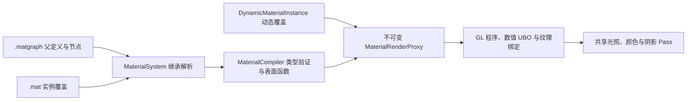

# 简化材质系统

第一版提供 PBR 父材质、参数实例、运行时动态覆盖和基础节点编辑。材质计算使用当前渲染器的直接光、环境 IBL 和阴影；材质 AO 影响间接光。材质系统本身不新增 Lightmap 或 GI。

## 从资产到画面



`.matgraph` 决定如何计算 Base Color、Metallic、Roughness、Normal、AO、Emissive、Opacity，并声明参数类型和默认值。`.mat` 只保存父引用和覆盖值。继承顺序是动态覆盖 → 当前实例 → 父实例 → 父图默认值。

对应 UE 的职责是：父图类似 `UMaterial`；资产实例类似 `UMaterialInstanceConstant`；运行时覆盖类似 `UMaterialInstanceDynamic`；渲染快照承担 `FMaterialRenderProxy` 的部分职责。这里使用 TinyEngine 的数据结构和 GLSL。

## 使用示例

`assets/Materials/M_Paint.matgraph` 是金属车漆父图。将 `MI_PaintRed.mat`、`MI_PaintBlue.mat` 分别赋给场景模型即可比较颜色。它们共享材质程序，仅覆盖 PaintColor。父图 Roughness 或 Metallic 默认值变化会同步影响两个实例；已覆盖的颜色保持各自的值。

`M_Masked.matgraph` 将 `T_Mask.ppm` 的 R 通道连接到 Opacity。`MI_Masked.mat` 使用这个父图，开启双面、Masked 和 0.5 截止值。主画面和阴影使用相同的裁切计算。

编辑器操作：

1. 在资产窗口选择 **新建资产 → Material graph**，打开父图。
2. 在参数声明面板添加参数，填写 ASCII 标识符、类型、显示名、分组和默认值。贴图参数选择 sRGB、Linear 或 Normal。
3. 添加参数节点，填写对应标识符。单击输出圆点，再单击输入圆点连线；右键输入圆点断开。拖动标题移动节点。
4. 选择节点编辑常量类型/值、参数名或 ComponentMask 分量；删除节点会删除关联连线。Vec4 接 Base Color 前需要 `xyz` 分量转换。
5. **Save / Apply** 完成 CPU 与当前 GPU 验证，成功后保存并更新场景。错误会显示节点和端口，草稿继续保留。
6. 选择父图或现有实例，再用 **新建资产 → Material instance** 创建实例。参数面板勾选 Override 修改；取消勾选恢复继承。
7. 将实例应用到当前模型；支持既有材质应用入口。选中材质时 **Ctrl+R** 显式重载外部修改。

切换资产时先保存或放弃当前脏稿。关闭窗口和退出编辑器提供 Save、Discard、Cancel。声明删除或改类型后，原来有效的覆盖显示为失效覆盖，使用新默认值；可移除或重新设置。首次加载未知或错误类型的覆盖会报错。

## 文件格式

实例只设置一个 `definition` 或 `parent`：

```text
TINY_MAT 2
definition "M_Paint.matgraph"
parameter "PaintColor" Vec3 0.65 0.025 0.015
parameter "Roughness" Float 0.3
```

```text
TINY_MAT 2
parent "MI_PaintRed.mat"
parameter "Metallic" Float 0.6
```

贴图覆盖写为 `texture "参数名" "相对路径"`。路径和文字使用引号，支持空格与中文。相对路径以引用文件所在目录解析，`assets/...` 以项目资产根目录解析；发布包使用逻辑路径。父实例链最多 32 层，循环会报告路径链。

节点和 link 记录可参照示例父图。`link <源节点> <源端口> <目标节点> <目标端口>`，当前节点输出端口均为 0。Surface 输出输入端口依次为 Base Color 0、Metallic 1、Roughness 2、Normal TS 3、AO 4、Emissive 5、Opacity 6。

旧 `.mat` 和 `TINY_MATGRAPH 1` 继续加载；旧图在内存中显式转换 RGB/Alpha 等端口，保存时写 v2。旧 RMA 实际通道保留：R=Roughness、G=AO、B=Metallic。旧材质的自定义 shader/parameter 兼容分支继续保留。

## 动态实例 C++

```cpp
auto &materials = renderer.GetMaterialSystem();
auto dynamic = materials.CreateDynamicInstance("assets/Materials/MI_PaintBlue.mat");
if (dynamic) {
    dynamic->SetParameter("PaintColor", MiniEngine::Vec3{1.0f, 0.8f, 0.02f});
    renderer.SetDynamicMaterial(entity, dynamic);
    // dynamic->ClearOverride("PaintColor"); 恢复资产继承值
}
```

动态实例绑定的资产必须与实体的材质路径一致。SetParameter 检查名字、类型和有限数值，失败不增加 revision。每个动态实例独立；相同程序和完整有效值可合批，不同值分开绘制。覆盖不写入场景，销毁实体后 Renderer 释放绑定。

## 首版边界

| 项目 | 支持范围 |
|---|---|
| 域、UV | Surface、UV0 |
| 参数 | Float、Vec2、Vec3、Vec4、Texture2D；64 个数值参数、8 个材质贴图 |
| 节点 | SurfaceOutput、Constant、Scalar/Vector/TextureParameter、TextureSample、TexCoord、Add、Multiply、Lerp、OneMinus、Clamp、ComponentMask、NormalDecode |
| 光照、混合 | Lit / Unlit；Opaque / Masked / Alpha；TwoSided |
| 几何、Pass | Static / Skinned / Instanced；Base / Shadow |
| 默认贴图 | 颜色与数据白色；法线精确平面法线；缺失路径提示一次 |

Alpha 沿用原透明排序/混合和随机透明阴影近似。当前姿态蒙皮同时用于主画面与阴影；精确前帧骨骼速度、静态开关、材质函数、顶点位移、清漆和折射尚未扩展。

数值 UBO 使用 binding 2、64×Vec4，共 1024 字节。材质纹理 0..7、阴影 8..10、环境 11..13、光照与 Cluster buffer 14..15。GL 程序按生成代码和模板内容缓存，参数值、贴图路径、节点位置、双面和 cutoff 不改变程序身份。

## 保存、打包与验证

候选先解析继承、编译表面函数，再验证颜色/阴影及几何变体。通过后原子写入并一起发布相关实例的新代际；失败保留原代码、布局、参数和贴图快照。只有首次加载失败时使用洋红色 Unlit 回退。

打包保留图和实例源文件，并执行离线 CPU 验证。`Saved/MaterialCache` 保存生成的 GLSL、槽布局和依赖摘要，程序键包含共享模板及 include 内容，避免时间戳触碰造成失效。离线验证不表示 GPU 链接已经通过，缓存不保存显卡驱动二进制。

外部模板与 CMake 嵌入模板来自同一份 `assets/shaders/material` 源码。缺失外部文件时用内置版本；共享 include 改变会触发 CMake 重新生成。运行时 Shader 重载先验证候选模板与当前材质，失败保留旧绑定。

自动化验收包含真实 OpenGL HDR/阴影读回、完整 ImGui 草稿操作与实际场景赋材质、失败恢复、包挂载后异目录读取、无外部 Shader 绘制，以及现有引擎回归。GPU 测试需要本机图形上下文。
