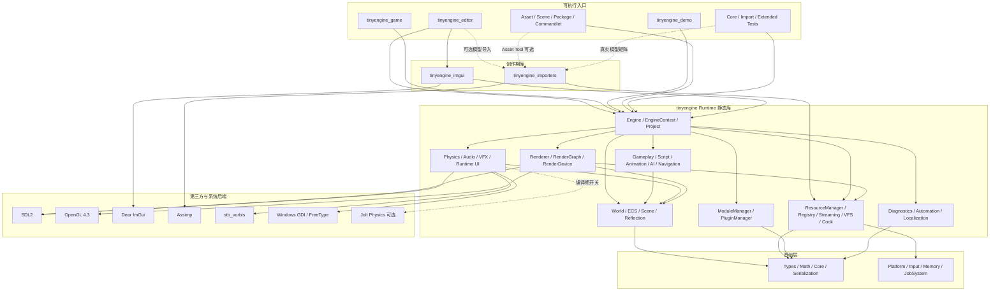
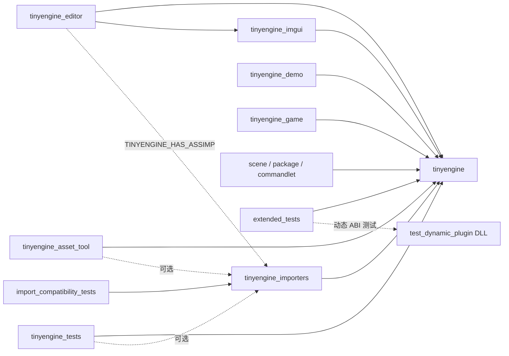
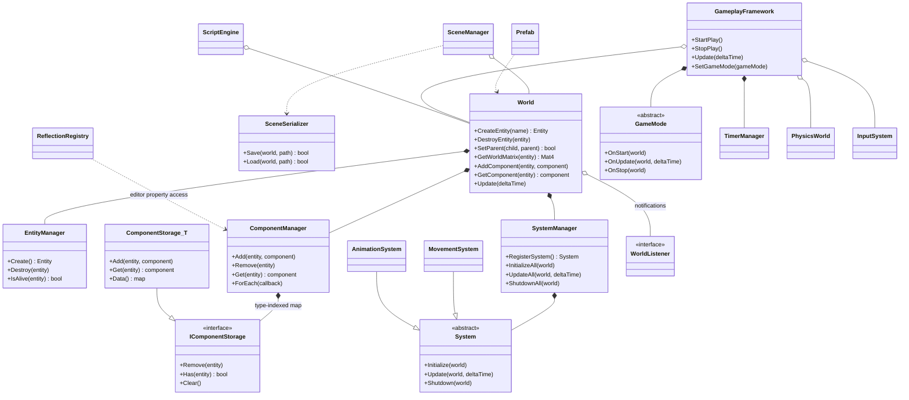
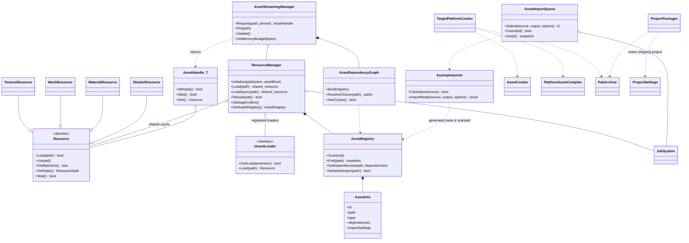
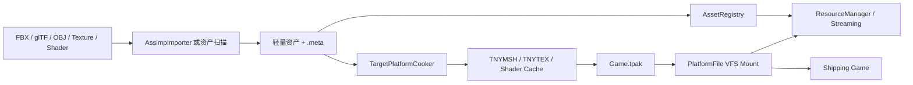
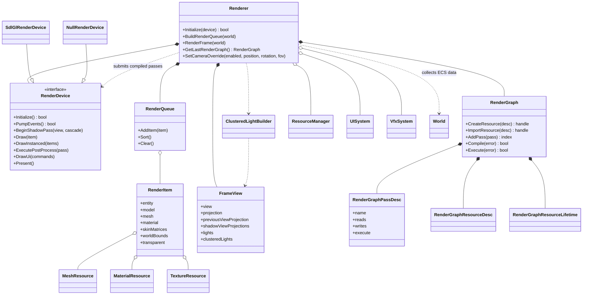
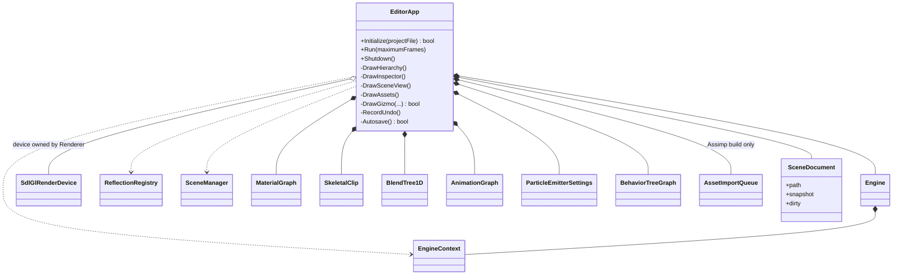

# TinyEngine 项目架构

本文以当前 `main` 分支源码和 CMake 目标为准，集中描述 TinyEngine 0.27.0 的分层、构建目标、核心类、生命周期、数据流和实现边界。资产格式版本与兼容规则另见 [资产与数据格式](资产与数据格式.md)。

## 1. 阅读约定

- 实线箭头表示编译期或运行期直接依赖。
- `*--` 表示对象按值或 `unique_ptr` 拥有，生命周期由左侧对象控制。
- `o--` 表示非拥有指针、回调或共享引用，左侧对象不能单独决定右侧对象的生命周期。
- `--|>` 表示继承或接口实现，`..>` 表示调用、创建或数据转换。
- 图中只列影响架构理解的核心类型，不把每个数据结构和编辑器临时状态都塞进同一张图。

## 2. 项目总架构图



关键约束：

1. `tinyengine` 不依赖 Dear ImGui 或 Assimp；Editor 和 Importer 是 Runtime 之上的创作期目标。
2. 游戏世界不直接调用 OpenGL。渲染通过 `RenderDevice` 接口进入 `SdlGlRenderDevice`。
3. Runtime 不读取 FBX/glTF 源文件。Assimp 只在创作期生成 `.mesh`、`.mat`、`.prefab`、Skeleton 和 Clip 等轻量资产。
4. `Engine` 显式控制服务初始化和逆序销毁，不使用 UE 风格的 UObject/GC 组合根。

## 3. 构建目标依赖图



## 4. Runtime 组合根类图

`Engine` 按值拥有主要服务。`EngineContext` 只汇总非拥有指针，供需要协作的上层代码读取，不负责释放服务。

```mermaid
classDiagram
    class Engine {
        +Initialize(projectFile, startInPlayMode) bool
        +Run(maxFrames)
        +Shutdown()
        +EnterPlayMode() bool
        +ExitPlayMode() bool
        +LoadScene(path) bool
        +SaveScene(path) bool
        -Tick(deltaTime)
        -EngineContext context
    }
    class EngineContext {
        +logger
        +jobSystem
        +resourceManager
        +world
        +renderer
        +physicsWorld
        +audioEngine
        +scriptEngine
        +sceneManager
        +uiSystem
        +gameplay
        +pluginManager
    }
    class WorldListener {
        <<interface>>
        +OnEntityDestroying(world, entity)
        +OnWorldCleared(world)
    }
    class ProjectSettings {
        +assetDirectory
        +startupScene
        +cookedDirectory
        +fixedStep
        +Load(path) bool
        +Resolve(path) path
    }
    class SceneManager {
        +LoadScene(path) bool
        +SaveScene(path) bool
        +CreateSnapshot() string
        +RestoreSnapshot(snapshot) bool
    }
    class GameInstance {
        <<abstract>>
        +OnInitialize()
        +OnSceneLoaded(path)
        +OnUpdate(deltaTime)
        +OnShutdown()
    }
    class World
    class Renderer
    class ResourceManager
    class AssetStreamingManager
    class JobSystem
    class MemoryManager
    class InputSystem
    class PhysicsWorld
    class AudioEngine
    class ScriptEngine
    class UISystem
    class GameplayFramework
    class DiagnosticsService
    class VfxSystem
    class NavigationGrid
    class WorldPartition
    class ModuleManager
    class PluginManager

    Engine --|> WorldListener
    Engine *-- ProjectSettings
    Engine *-- SceneManager
    Engine *-- World
    Engine *-- Renderer
    Engine *-- ResourceManager
    Engine *-- AssetStreamingManager
    Engine *-- JobSystem
    Engine *-- MemoryManager
    Engine *-- InputSystem
    Engine *-- PhysicsWorld
    Engine *-- AudioEngine
    Engine *-- ScriptEngine
    Engine *-- UISystem
    Engine *-- GameplayFramework
    Engine *-- DiagnosticsService
    Engine *-- VfxSystem
    Engine *-- NavigationGrid
    Engine *-- WorldPartition
    Engine *-- ModuleManager
    Engine *-- PluginManager
    Engine *-- GameInstance
    Engine *-- EngineContext
    SceneManager o-- World : non-owning
    AssetStreamingManager o-- ResourceManager : non-owning
    ResourceManager o-- JobSystem : non-owning
    GameplayFramework o-- World : non-owning
    GameplayFramework o-- InputSystem : non-owning
    GameplayFramework o-- PhysicsWorld : non-owning
    EngineContext o-- World : service view
    EngineContext o-- Renderer : service view
    EngineContext o-- ResourceManager : service view
```



初始化顺序的主干是：Diagnostics/Project → Memory → JobSystem → Resource → World → Gameplay → Renderer → Audio/Script → Module/Plugin → Scene → Play。销毁时按依赖大致逆序执行，插件会在核心服务销毁前卸载。

## 5. ECS、场景与 Gameplay 类图



组件是纯数据。常用组件分为：

| 领域 | 组件 |
| --- | --- |
| 身份与层级 | `NameComponent`、`ActiveComponent`、`TagComponent`、`LayerComponent`、`RelationshipComponent` |
| 空间与渲染 | `TransformComponent`、`MeshComponent`、`LodComponent`、`CameraComponent`、`LightComponent` |
| Gameplay | `ScriptComponent`、`PawnComponent`、`CharacterControllerComponent` |
| 物理 | `VelocityComponent`、`RigidBodyComponent`、`ColliderComponent`、`JointComponent` |
| 动画与音频 | `AnimationComponent`、`AudioSourceComponent` |

`Entity` 使用 index + generation 句柄；组件按类型进入稀疏的 `ComponentStorage<T>`，不是每个实体持有一个多态组件数组。

## 6. 资源与资产管线类图



资产从创作到发布的数据流：



## 7. 渲染架构类图



当前一帧的主路径：


`Renderer` 负责从 World 收集后端无关的 `RenderItem` 和构建每帧图；`SdlGlRenderDevice` 负责 OpenGL 资源、Shader、Compute/Indirect、实际 Draw 和 Present。这样以后增加其他图形后端时，不需要让 ECS 或 Gameplay 依赖图形 API。

## 8. Editor 与 Runtime 类图



Editor 不维护第二套 Runtime World。场景标签保存序列化快照；切换标签时由 `SceneManager` 将目标快照恢复到同一个 `World`。Play 前保存编辑快照，Stop 后恢复，以隔离运行态修改。

## 9. 每帧时序图

```mermaid
sequenceDiagram
    participant Loop as Engine::Run
    participant Device as RenderDevice
    participant UI as UISystem/InputSystem
    participant Gameplay as Gameplay/Script/Plugin
    participant World as World Systems
    participant Physics as PhysicsWorld
    participant Audio as AudioEngine
    participant Renderer as Renderer
    participant Stats as Diagnostics/Streaming

    Loop->>Device: PumpEvents()
    Device-->>Loop: InputState
    Loop->>UI: Update input, focus and text
    alt not paused and deltaTime > 0
        Loop->>Gameplay: Update(deltaTime)
        Loop->>World: Update(deltaTime)
        Loop->>Physics: Step(fixedStep), zero or more times
        Loop->>Audio: UpdateWorld(world)
    end
    Loop->>Renderer: RenderFrame(world)
    Renderer->>Device: graph passes, draw, UI, present
    Loop->>Stats: publish frame/resource/job counters
    opt every 60 frames
        Loop->>Stats: AssetStreamingManager::Update()
    end
```

## 10. 模块定位表

| 修改目标 | 首选入口 | 主要协作者 |
| --- | --- | --- |
| 引擎生命周期、Play/Stop | `Runtime/Engine.hpp`、`src/Runtime/Engine.cpp` | Project、World、各 Runtime 服务 |
| 实体、组件、System | `ECS/ECS.hpp`、`ECS/Components.hpp` | SceneSerializer、Reflection |
| 场景、Prefab、项目 | `Project/Project.hpp` | World、SceneSerializer、Packager |
| 资源加载与流式 | `Resource/ResourceManager.hpp`、`AssetStreaming.hpp` | AssetRegistry、JobSystem、PakArchive |
| 模型导入 | `Import/AssimpImporter.hpp` | Assimp、JobSystem、AssetRegistry |
| 渲染帧组织 | `Render/Renderer.hpp`、`RenderGraph.hpp` | World、ResourceManager、RenderDevice |
| OpenGL 后端 | `Render/SdlGlRenderDevice.hpp` | SDL2、OpenGL、ShaderPipeline |
| 物理与角色移动 | `Physics/PhysicsWorld.hpp` | Collider/RigidBody、Gameplay |
| 动画 | `Animation/SkeletalAnimation.hpp`、`ECS/Systems.hpp` | AnimationComponent、Renderer |
| Runtime UI 与文字 | `UI/UISystem.hpp`、`UI/TextLayout.hpp` | InputState、FontRasterizer、RenderDevice |
| 编辑器界面 | `editor/EditorApp.hpp/.cpp` | EngineContext、Reflection、ImGui |
| 插件和内建模块 | `Plugin/PluginManager.hpp`、`Core/Module.hpp` | Plugin C ABI、Engine 生命周期 |
| Cook 与打包 | `Build/TargetPlatform.hpp`、`ProjectPackager.hpp` | AssetCooker、PlatformAssetCompiler、TPAK |

## 11. 新模块接入原则

1. 纯算法或数据格式优先放在 Runtime 的独立命名空间目录，不依赖 Editor、Assimp 或 OpenGL。
2. 需要逐帧运行的服务由 `Engine` 显式持有并纳入初始化、Tick、Shutdown；跨服务访问优先通过窄接口，必要时才加入 `EngineContext`。
3. 新 ECS 数据使用组件，新行为使用 System 或 Gameplay 服务；不要把游戏规则重新硬编码进 `Engine::Tick`。
4. 新源资产格式在 Importer/Asset Tool 转换，Runtime 只加载版本化轻量格式。
5. 新渲染能力先扩展后端无关数据或 `RenderDevice` 接口，再在 `SdlGlRenderDevice` 实现；禁止从 World 直接调用 OpenGL。
6. 新持久化类型必须同步序列化版本、迁移、自动测试和文档。

## 12. UE 5.3.2 职责映射

TinyEngine 参考 UE 的职责划分，但使用显式对象生命周期、ECS 和轻量文件格式，不复制 UObject/UHT/GC 等大型基础设施。

| TinyEngine | UE 参考职责 | TinyEngine 的删减策略 |
| --- | --- | --- |
| Project、SceneManager、GameInstance | Projects、UGameInstance、UWorld | 小型配置和显式生命周期 |
| World、ECS、Prefab | Actor、Component、Level | generation Entity 与按类型组件存储 |
| AssimpImporter、Registry、Cook、TPAK | Interchange、AssetRegistry、Cook、PakFile | 创作期转换为轻量运行时资产 |
| Renderer、RenderDevice | Renderer、RenderCore、RHI | Render Graph 与 OpenGL 4.3 单后端 |
| PhysicsWorld | Chaos、PhysicsCore | 内建轻量后端，可选 Jolt 接口 |
| UISystem、TextLayout | UMG、Slate Runtime | Widget、动态 Glyph Atlas、布局和焦点模型 |
| EditorApp | UnrealEd、LevelEditor | Dear ImGui 独立工具，仅覆盖高频工作流 |
| Archive、Migration | Archive、Custom Version | 小端二进制与版本化文本迁移 |
| Gameplay、Diagnostics、Commandlet | Gameplay Framework、Console、Commandlet | ECS 控制器、Timer、CVar、Stat 与无头批处理 |
| Animation、VFX | AnimationCore、AnimGraph、Niagara | 轻量曲线/图资产和 CPU/GPU 两条路径 |
| Navigation、AI | NavigationSystem、BehaviorTree、EQS | 网格/多边形 A*、轻量 Crowd/EQS |
| Network、Replay | NetCore、Replication、Replay | UDP/可靠通道/RPC/预测原语，无 Online Subsystem |
| PluginManager | Modules、Projects | 稳定 C ABI，不暴露 C++ 引擎对象 ABI |

## 13. 关键实现边界

| 领域 | 当前实现 | 有意保留的边界 |
| --- | --- | --- |
| 渲染 | 九 Pass Render Graph、Forward+、CSM、HZB、GTAO、Bloom、Motion Vector TAA、GPU Indirect | 只有 OpenGL 4.3；没有跨 API Barrier、Descriptor、异步 Compute 或全场景 MDI |
| 资产 | Assimp 创作期导入、Registry、增量 Cook、TPAK、VFS、预算流式加载 | Runtime 不解析 FBX/glTF；BC6H/BC7 编码由平台离线工具提供 |
| 物理 | 基础刚体、Convex/Triangle Mesh、Sweep、角色台阶/坡度、Joint，可选 Jolt | 内建后端不是大型复杂堆叠的生产级求解器 |
| 动画 | Skeleton/Clip、曲线压缩、事件、Root Motion、1D/2D Blend、Graph、重定向、Two Bone IK、分层混合、GPU Skinning | 没有 Full Body IK、IK Rig 链或 Motion Warping |
| Runtime UI | UTF-8、轻量 BiDi/连字/富文本、动态 Glyph Atlas、输入/列表/下拉/进度控件 | 未强制依赖完整 HarfBuzz/OpenType Shaping |
| 导航与 AI | 网格和多边形 A*、动态障碍、Crowd、EQS、Blackboard、Behavior Tree | 没有完整 Recast 体素烘焙、Detour Funnel/Tile Cache |
| 联网 | UDP、可靠通道、RPC 白名单、Ownership、客户端预测、快照与回放 | 没有握手认证、加密、NAT、会话匹配、分片和大型 Replication Graph |
| 扩展 | 内建 Module 依赖拓扑与动态/静态插件 ABI v1 | 插件 ABI 只开放生命周期、日志和内存基础，不支持任意 C++ 对象热替换 |
| 编辑器 | 单 World 快照式多文档、反射 Inspector、Undo、Autosave、资产与专项图编辑器 | 当前不是多 World/Docking 完整生产编辑器，已知问题见故障清单 |
| 诊断 | Console/Stat、结构化日志、Windows Crash Dump、Commandlet、自动测试 | 跨平台崩溃采集与长期性能基线仍需发布工程补充 |

持久化格式遵守三个规则：新格式必须有 Magic 和版本；读取端保持明确的旧版本兼容范围；新增持久化组件必须同时更新 Serializer、迁移、测试和 [资产与数据格式](资产与数据格式.md)。
